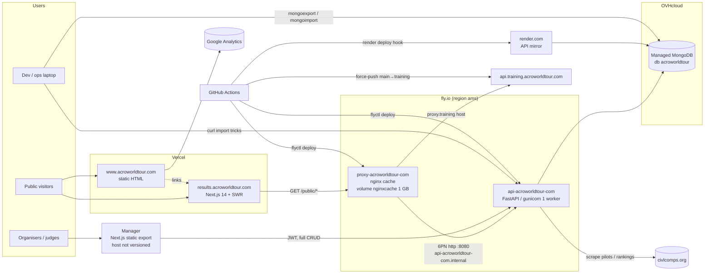

# 01 — Current architecture (legacy AcroWorldTour stack)

> Source analysed: legacy monorepo `github.com/fatpat/acroworldtour.com` (branches `main`, `training`, `lukedeweert`), 502 commits 2023-05 → 2026-10 (351 in 2023, 113 in 2024, 34 in 2025, 4 in 2026). Authors: Jérôme Loyet (API, manager, infra), Pierre-François Salmand (results site), Luke de Weert (www content).
> Paths are relative to the legacy repo root. Items marked *(inferred)* are not versioned in the repo and are deduced from names/history — confirm with the owner.

## 1. Components

| Component | Folder | Tech | Role | Prod URL | Hosting |
|---|---|---|---|---|---|
| **API** ("acropyx2") | `api/` | Python 3.10, FastAPI, Motor/PyMongo, Pydantic v2, gunicorn + 1 uvicorn worker, Jinja2 (HTML/PDF-ish exports), openpyxl (CIVL xlsx), httpx+lxml (CIVL scraping), python-jose (JWT) | Single back-end: CRUD for pilots, teams, judges, tricks, competitions, runs, flights/marks, seasons, files; scoring engine; public read-only endpoints under `/public`; CIVL exports. | `https://api.acroworldtour.com` (Swagger at `/docs`, OpenAPI at `/openapi.json`) | fly.io app `api-acroworldtour-com`, region `ams` (`api/fly.toml:6-7`). Mirror deployed on render.com (`.github/workflows/main.yml:19-29`, `api-acroworldtour-com.onrender.com` in history, commit `3da28f4`). |
| **Caching proxy** | `proxy/` | nginx (official image) | Read-through cache in front of the API's `/public/*` endpoints, adds CORS + Cache-Control. | `https://proxy.acroworldtour.com` (+ `proxy.training.acroworldtour.com`) | fly.io app `proxy-acroworldtour-com`, region `ams`, persistent volume `nginxcache` → `/cache` (`proxy/fly.toml:6-21`). |
| **Results site** | `results/` | Next.js 14.2 (pages router), React 18, TypeScript, Tailwind 3, MUI 5, SWR (client-side fetching), openapi-typescript | Public results: seasons, competitions, runs, pilots, live. Reads only `/public` API. | `https://results.acroworldtour.com` | Vercel *(inferred: `.vercel` in `results/.gitignore`, `results/vercel.json` existed in May 2023, no CI workflow)*. |
| **Manager** (back-office) | `manager/` | Next.js 14.2 static export (`output: 'export'`, `manager/next.config.js:4`), React 18, MUI 5 + MUI X (DataGrid, DatePickers), dnd-kit, ApexCharts, `@auth0/nextjs-auth0` client (only used as a `UserProvider` with a custom fetcher; no Auth0 tenant), jQuery | Admin UI for organisers/judges: manage entities, run competitions, enter marks, export CIVL results/PDF starting orders. Calls the API directly (not through the proxy) with a JWT stored in `localStorage`. | Unknown in repo *(inferred: Vercel or any static host; dev on port 3001)* | Static files. |
| **Institutional site** | `www/` | Static HTML/CSS + Flickity | Marketing site (news, events, pilots, legacy results). See `07-www.md`. | `https://www.acroworldtour.com` | Vercel (`www/vercel.json`), `.htaccess` kept for Apache compatibility. |
| **Database** | — | MongoDB. Prod: **OVHcloud Managed MongoDB** cluster (`*.database.cloud.ovh.net`, `mongodb+srv`, TLS, replica set, db `acroworldtour`) (`docker-compose.yml:12-13`, commented). Dev: `mongo:5.0` container (`docker-compose.yml:55-64`). Prod engine version not in repo. | Collections exported by tooling: `pilots teams judges tricks competitions seasons files` (`utils/Makefile:3`). Binary files (pilot photos, etc.) are stored **inside Mongo** (`api/models/files.py:17`), served via `/public/files/...`. | — | OVHcloud (managed) |
| **Redis** | — | `redis:alpine` container (`docker-compose.yml:66-67`) | **Dead**: API caching via Redis was added (`189ab05`) then removed in favour of the nginx proxy (`730c5bc`). Only a leftover import remains (`api/main.py:9`) and a disabled env `_REDIS_URL` (`docker-compose.yml:15`). | — | — |
| **External: CIVL** | — | civlcomps.org | Source of pilot identity/ranking (scraped with CSRF token, `api/controllers/pilots.py:35-80`; links in `api/core/config.py:29-31`); destination of results exports. | — | third party |
| **External: Google Analytics** | — | GA4 `G-LYV0V2T0BQ` | www analytics. | — | third party |

### 1.1 Domains / environments

| Hostname | Points to | Env |
|---|---|---|
| `www.acroworldtour.com` | Vercel static (`www/`) | prod |
| `results.acroworldtour.com` | Vercel Next.js (`results/`) *(inferred)* | prod |
| `api.acroworldtour.com` | fly.io `api-acroworldtour-com` (ports 80/443 public, `api/fly.toml:22-29`) | prod |
| `proxy.acroworldtour.com` | fly.io `proxy-acroworldtour-com` → `http://api-acroworldtour-com.internal:8080` (fly private network) | prod |
| `api.training.acroworldtour.com` | Training API (built from branch `training`) *(inferred: render.com or a second fly app — not versioned)* | training |
| `proxy.training.acroworldtour.com` | same proxy app, host-based routing to `https://api.training.acroworldtour.com` (`proxy/nginx.conf:6-10`) | training |
| `api-preprod.acroworldtour.com` | Historical (2023) pre-prod API, referenced only in history (`git log -S api-preprod`) | defunct |
| `api-acroworldtour-com.onrender.com` | render.com mirror of the API ("backup API domain", commit `3da28f4`) | backup |
| Manager host | not in repo | prod |

Environments known to tooling: `PROD`, `PREPROD`, `TRAINING`, `DEV` (`utils/Makefile:15,27`, Mongo URIs `ACROPYX_MONGO_<ENV>` from the git-ignored `mongo.pass.env`).

## 2. Architecture diagram

## 3. nginx caching proxy (`proxy/`)

### 3.1 Container / fly config
| Item | Value | Ref |
|---|---|---|
| Image | `FROM nginx`, config copied to `/etc/nginx/conf.d/default.conf` | `proxy/Dockerfile:1-2` |
| Listen | `8080` | `proxy/nginx.conf:15`, `proxy/fly.toml:12` |
| HTTPS | Terminated by fly edge, `force_https = true` | `proxy/fly.toml:13` |
| Machines | always 1 running, no auto-stop/start | `proxy/fly.toml:14-16` |
| Cache storage | `proxy_cache_path /cache/nginx levels=1:2 keys_zone=static:8m max_size=1g` on fly volume `nginxcache` | `proxy/nginx.conf:4`, `proxy/fly.toml:19-21` |
| DNS resolver | `[fdaa::3]` (fly internal DNS) — required because `proxy_pass` uses a variable | `proxy/nginx.conf:16` |
| Logs | custom `access` format incl. `$request_time $upstream_cache_status` | `proxy/nginx.conf:1-2` |
| Access control | `allow all`; an IP deny (`91.190.12.245`) was added 2025-10 and removed 2026-06 | `proxy/nginx.conf:18-19` |

### 3.2 Upstream routing
`map $http_host $proxy` (`proxy/nginx.conf:6-10`):
- default → `http://api-acroworldtour-com.internal:8080` (plain HTTP over fly private WireGuard network)
- `proxy.training.acroworldtour.com` → `https://api.training.acroworldtour.com` (over the Internet, `proxy_ssl_server_name on`). Note `Host` is forced to the *incoming* host (`proxy_set_header Host $host`, l.45), so the training upstream receives `Host: proxy.training…`.

### 3.3 Global cache behaviour (server block, `proxy/nginx.conf:25-47`)
| Directive | Value | Meaning |
|---|---|---|
| `location /` | `return 404` | Only `/public*` is exposed; admin endpoints are **not** reachable through the proxy. |
| `proxy_cache_key` | `$proxy$request_uri` | Upstream + path + query string; prod and training never collide. |
| `proxy_cache_methods` | GET HEAD (`convert_head on`) | |
| `proxy_cache_min_uses` | 1 | cache on first hit |
| `proxy_cache_valid any` | 1m (default, overridden per location) | **`any` also caches 4xx/5xx** responses. |
| `proxy_cache_use_stale` | error timeout invalid_header updating http_500/502/503/504 | Serves stale content when the API is down → good resilience. |
| `proxy_cache_background_update` | on | stale-while-revalidate behaviour. |
| `proxy_cache_revalidate` | on | conditional requests to upstream. |
| `proxy_cache_lock` | off (lock_age / lock_timeout 5s are therefore inert) | Cache stampede possible on cold keys. |
| `proxy_ignore_headers` | Cache-Control Expires X-Accel-Expires | upstream caching headers ignored; TTL decided only by nginx. |
| `proxy_hide_header` | Cache-Control, Expires, X-Accel-Expires, Access-Control-Allow-Origin | replaced by proxy-set headers. |
| `X-Forwarded-For` | `$remote_addr` | API trusts it (`--forwarded-allow-ips *`, `api/Dockerfile.fly.io:12`). |

### 3.4 Per-path TTLs
| Location | nginx TTL | `Cache-Control` sent to clients | Ref |
|---|---|---|---|
| `/public` (catch-all) | 5 min | `public, max-age=300` | `proxy/nginx.conf:49-55` |
| `/public/pilots` | 1 h | `public, max-age=3600` | `:57-63` |
| `/public/teams` | 1 h | `max-age=3600` | `:65-71` |
| `/public/judges` | 1 h | `max-age=3600` | `:73-79` |
| `/public/tricks` | 1 h | `max-age=3600` | `:81-87` |
| `/public/seasons` | 10 min | `max-age=600` | `:89-95` |
| `/public/competitions` | 1 min | `max-age=60` | `:97-103` |
| `/public/live` | **not cached** | `no-cache` | `:105-111` |
| `/public/simulate` | **not cached** | `no-cache` | `:113-119` |
| `/public/files` | 1 year | `max-age=31536000` | `:121-127` |

All locations add `Access-Control-Allow-Origin: *` and `X-Cache-Status: $upstream_cache_status`. There is **no purge mechanism**: after a result is corrected in the manager, the public site can show stale data for up to 1 min (competitions) / 10 min (seasons) / 1 h (pilots) plus browser cache; a corrected file under the same id stays cached 1 year.

## 4. Docker setup

### 4.1 Local dev — `docker-compose.yml`
| Service | Image / build | Port | Mounts | Notes |
|---|---|---|---|---|
| `api` | build `./api` (`api/Dockerfile`) | 8000 | `./api:/app` | Dockerfile CMD creates a venv **at container start** and `pip install`s every boot, then `uvicorn --reload` on controllers/core/models/routers (`api/Dockerfile:8`). |
| `manager` | `node:20-alpine` | 3001 | `./manager:/app` | `npm i -g pnpm && pnpm install && pnpm run dev` at each start. |
| `results` | `node:20-alpine` | 3000 | `./results:/app` | same pattern; API = `http://127.0.0.1:8000/public` (works only from the host browser). |
| `www` | `nginx` | 3002 | `./www` (ro) + `utils/nginx.vhost.www.conf` | clean URLs via `try_files`. |
| `mongodb` | `mongo:5.0` | 27017 (exposed on host) | `./mongo:/data/db` | root user/pass from env; `--setParameter processUmask=022`. |
| `redis` | `redis:alpine` | — | — | unused. |

### 4.2 Production images
| File | Base | Build / run | Ref |
|---|---|---|---|
| `api/Dockerfile.fly.io` | `python:3.10-alpine` | `COPY . .`, `apk add build-base`, `pip install -r requirements.txt` (all deps **unpinned**, incl. pytest, flake8, mongomock in prod image), `gunicorn main:app --workers 1 -k uvicorn.workers.UvicornWorker -b [::]:8080 --forwarded-allow-ips * --access-logfile -` | `api/Dockerfile.fly.io:1-12` |
| `api/Dockerfile` | `python:3.10-alpine` | dev only (see above) | `api/Dockerfile:1-8` |
| `proxy/Dockerfile` | `nginx` (untagged → latest) | copy config | `proxy/Dockerfile` |

`api/.dockerignore` excludes only `__pycache__/*` and `venv-docker/*` (note: the venv dir is actually `.venv-docker`, so it is **not** excluded; tests and samples also ship).

### 4.3 fly.io API service (`api/fly.toml`)
- `kill_signal SIGINT`, `kill_timeout 5`, `[experimental] auto_rollback = true`.
- Public TCP service on internal port 8080, ports 80 (http, force_https) + 443 (tls+http).
- Concurrency: connections, soft 20 / hard 25.
- Health: TCP check every 15 s, timeout 2 s (no HTTP health endpoint check even though `/status` exists).
- No `[env]` for DB or secrets → they are set with `fly secrets` *(inferred)*.

## 5. CI/CD (GitHub Actions, `.github/workflows/`)

| Workflow | Trigger | Jobs | Ref |
|---|---|---|---|
| `main.yml` "Deploy API to prod" | push to `main` touching `api/**` | (1) `flyctl deploy --remote-only --dockerfile Dockerfile.fly.io --wait-timeout 600` in `api/` with `FLY_API_TOKEN`; (2) render.com deploy via `JorgeLNJunior/render-deploy@v1.3.2` with `RENDER_SERVICE_ID`, `RENDER_API_KEY`, `wait_deploy: true`. Both in parallel, **no tests, no lint, no build gate**. | `.github/workflows/main.yml:1-29` |
| `proxy.yml` "Deploy proxy to prod" | push to `main` touching `proxy/**` | `flyctl deploy --remote-only` in `proxy/` | `.github/workflows/proxy.yml:1-17` |
| `main_to_training.yml` | every push to `main` | `git push origin main:training --force` → the training environment always mirrors main (training deploy itself is done by the hosting platform watching branch `training`) *(inferred)* | `.github/workflows/main_to_training.yml:1-12` |

Not in CI: `results/`, `manager/`, `www/` (deployed by Vercel's Git integration *(inferred)*), the API test-suite (`api/tests/`, run manually via `api/Makefile:10-11` inside docker-compose). Actions are pinned to mutable refs (`superfly/flyctl-actions/setup-flyctl@master`, `actions/checkout@v3`).

`api/Makefile:4-8` targets `deploy-preprod` / `deploy-prod` call `make` in the repo root, but **there is no root Makefile** → broken/obsolete.

## 6. Environment variables

### 6.1 API (`api/core/config.py`, pydantic-settings, case-sensitive; every field is overridable)
| Var | Default | Used for | Ref |
|---|---|---|---|
| `MONGODB_URL` | `mongodb://127.0.0.1/` | Motor client (`timeoutMS=1000`) | `config.py:18`, `core/database.py:10` |
| `DATABASE` | `acropyx2-database-developtment` | DB name. **If it contains "test", the DB is wiped at startup** (`main.py:25-27`). | `config.py:19` |
| `TESTDB` | None | unused | `config.py:20` |
| `ADMIN_USER` | `admin` | single admin login | `config.py:22` |
| `ADMIN_PASS` | None | if unset **authentication is disabled entirely** (`core/security.py:94-98`) | `config.py:23` |
| `JWT_SECRET` | hard-coded test value | HS256 signing of admin tokens | `config.py:12` |
| `JWT_ALGORITHM` | `HS256` | | `config.py:13` |
| `ACCESS_TOKEN_EXPIRE_MINUTES` | 11520 (8 days) | token lifetime | `config.py:15` |
| `LOG_LEVEL` | `INFO` | | `config.py:27` |
| `PROJECT_NAME`, `PROJECT_DESCRIPTION`, `VERSION` (`2025.4`) | | OpenAPI metadata, `/status` | `config.py:9-11` |
| `CACHE_EXPIRES`, `_REDIS_URL`, `SERVER_HOST` | — | set in compose but **not read** by the code (dead) | `docker-compose.yml:14-17` |

Scoring constants (judge weights, mark percentages, warnings, bonus caps, max tricks per type) are hard-coded class attributes in `api/core/config.py:57-79` (not env-driven) — changing a rule requires a deploy.

### 6.2 Front-ends
| Component | Var | Value (dev) | Ref |
|---|---|---|---|
| results | `NEXT_PUBLIC_API_URL` | `http://127.0.0.1:8000/public`; fallback `https://api.acroworldtour.com/public` (prod build likely set to `https://proxy.acroworldtour.com/public` on Vercel *(inferred from `results/next.config.js:19-22` image domains)*) | `docker-compose.yml:42`, `results/constants.ts:4-5` |
| results | `NEXT_CACHE_DURATION` | `1` — not referenced in code (dead) | `docker-compose.yml:44` |
| results, manager | `NEXT_TELEMETRY_DISABLED` | `1` | |
| manager | `NEXT_PUBLIC_API_URL` | `http://127.0.0.1:8000` (full API root, not `/public`) | `docker-compose.yml:28`, `manager/src/util/backend.js:24,59` |
| manager | `NEXT_PUBLIC_BORDER_COLOR` | `blueviolet` (visual marker of non-prod env) | `docker-compose.yml:30` |

### 6.3 Ops tooling
| Var | Where | Ref |
|---|---|---|
| `ACROPYX_MONGO_PROD`, `ACROPYX_MONGO_PREPROD`, `ACROPYX_MONGO_TRAINING`, `ACROPYX_MONGO_DEV` | `mongo.pass.env` at repo root (git-ignored, `.gitignore:6`), included by `utils/Makefile:2` | |
| `FLY_API_TOKEN`, `RENDER_SERVICE_ID`, `RENDER_API_KEY` | GitHub repository secrets | `.github/workflows/*.yml` |

## 7. Data management & import process

### 7.1 Database backup / copy between environments (`utils/Makefile`)
- `make export from=<PROD|PREPROD|TRAINING|DEV> [to=file.tar.gz]` → `mongoexport` of the 7 collections (`pilots teams judges tricks competitions seasons files`) to JSON, tarred as `mongo.backup.<YYYYMMDD-HHMM>.tar.gz` (`utils/Makefile:13-23`).
- `make import from=<file> to=<ENV>` → for each collection `deleteMany({})` then `mongoimport` (`utils/Makefile:25-36`). **No confirmation, no dry-run; `to=PROD` is allowed** — one typo wipes production.
- Run manually from a laptop with `mongosh`/mongo-tools installed. No scheduled backup is versioned (OVH managed backups *inferred*).
- `mongoexport` JSON loses BSON type fidelity (dates/ObjectIds are extended-JSON; generally fine but `mongodump` would be safer).

### 7.2 Yearly trick catalogue (`import/`)
| Year | Files | Change vs previous |
|---|---|---|
| `import/2022/tricks/` | 48 | initial |
| `import/2023/tricks/` | 48 | content edits on all files |
| `import/2024/tricks/` | 51 | + `types`, `tricks_constraints`, `solo_awt`, more `connection` texts |
| `import/2025/tricks/` | 56 | + bitch_switch_helicopter, gearbox_damage, mac_twist_to_sat, super_cowboy, x_chopper_to_sat (commit `add6ffd`, 2025-04-30) |

One JSON file per trick (snake_case filename). Example `import/2025/tricks/misty_to_heli.json`:

| Field | Type | Consumed by API model? (`api/models/tricks.py:66-85`) |
|---|---|---|
| `name`, `acronym` | string | yes |
| `types` | string[] (e.g. `tumbling`, `to infinite`) — used for `max_tricks_per_type` | yes |
| `solo`, `solo_awt`, `synchro` | bool — trick allowed in solo / solo-AWT / synchro | yes |
| `directions` | `["left","right"]` / `["opposite"]` / `[]` | yes |
| `technical_coefficient` | float | yes |
| `bonuses` | `[{name, bonus}]` (bonus = % added, names from `api/core/config.py:34-49`) | yes |
| `bonus_constraints` | `[[bonusA, bonusB], …]` mutually exclusive | yes |
| `tricks_constraints` | trick names that can't be flown in the same competition | yes |
| `first_maneuver`, `no_first_maneuver`, `last_maneuver`, `no_last_maneuver` | int (N first/last tricks rules) | yes |
| `repeatable` | bool | yes |
| `description`, `criterias` {normal, twisted, reverse, …}, `minimum`, `connection` | judging documentation | **no — silently dropped** |
| legacy/inconsistent keys: `Minimum`, `minimums`, `alt_name`, `name_alt`, `name_short`, `repetition_allowed`, `forbid_last_two`, `only_last_two` | | **no — ignored** (rules such as "forbid last two" are therefore not enforced from these files) |

Import procedure (`import/README.txt`): a shell loop `curl -X PUT -d @file https://api.acroworldtour.com/tricks/<urlencoded name>` with a Bearer token copied by hand from the Swagger UI. Caveats:
- `PUT /tricks/{id}` (`api/routers/tricks.py:134-146`) **only updates an existing trick** (looked up by `_id` or `name`) and returns 204 even if nothing matched → new tricks must be created with `POST /tricks` or bulk `POST /tricks/import` (list body, `api/routers/tricks.py:107-129`).
- The API generates all variants (`TrickCtrl.generate_tricks`) on write.
- Tricks are global (not versioned per season in DB): importing 2025 overwrites the 2024 definitions used to score past competitions *(verify whether competitions snapshot their trick list)*.
- Pilots are not imported from files: they are pulled from CIVL (xlsx/HTML scraping, `api/controllers/pilots.py`).

## 8. Operational pain points

| # | Pain point | Evidence |
|---|---|---|
| 1 | **Four hosting providers** (fly.io ×2 apps + volume, render.com, Vercel ×2–3 projects, OVHcloud Managed MongoDB) plus GitHub; each with its own dashboard, secrets and billing. | §1 |
| 2 | Double API deployment (fly + render) on each push, in parallel, with no tests; render mirror is a "backup" that must be kept compatible with the same DB. | `.github/workflows/main.yml` |
| 3 | No CI for 3 of 5 components; no automated tests gate; tests must be run manually in docker-compose. | §5 |
| 4 | Infra config partly outside the repo: DNS, Vercel projects/env vars, fly secrets, training environment, manager hosting, OVH Mongo settings. Bus factor ≈ 1. | §1.1 |
| 5 | Training env is a forced mirror of `main` (force-push) — cannot test a change on training *before* prod. | `main_to_training.yml` |
| 6 | Cache invalidation is time-based only; organisers see corrected results late on the public site; errors are cached too (`proxy_cache_valid any`). | §3 |
| 7 | Single admin account, shared password, 8-day JWT in `localStorage`, auth **fail-open** if `ADMIN_PASS` missing. | `api/core/security.py:94-98` |
| 8 | Dangerous footguns: DB wipe at startup if DB name contains "test" (`api/main.py:25-27`); `make import to=PROD` deletes all collections without confirmation (`utils/Makefile:34`). | |
| 9 | Unpinned Python dependencies and unpinned base images (`nginx`, `python:3.10-alpine` — Python 3.10 EOL Oct 2026) → non-reproducible builds. | `api/requirements.txt`, Dockerfiles |
| 10 | Dead code/config: Redis service & import, `CACHE_EXPIRES`, `NEXT_CACHE_DURATION`, `SERVER_HOST`, `TESTDB`, `api/Makefile` deploy targets, `results` husky hook pointing at `manager/.husky` (`results/package.json:73`), render.com mirror. | |
| 11 | Data duplication: www hand-copies results, pilots and calendar that exist in the API; trick documentation (criteria, minimums) lives in JSON files and the FAI PDF but not in the DB. | `07-www.md` §9 |
| 12 | Binary files stored in MongoDB and served through the API (cached 1 y by proxy) instead of object storage/CDN. | `api/models/files.py` |
| 13 | Scoring rule constants hard-coded in Python (`api/core/config.py:57-79`) — yearly Sporting Code changes require code changes & redeploy; no per-season rule versioning. | |
| 14 | Dev containers reinstall all dependencies at every start (`api/Dockerfile:8`, compose node services). | |
| 15 | Ad-hoc abuse handling (IP deny added/removed by hand in proxy & API). No rate limiting, no WAF. | `proxy/nginx.conf:18`, `api/main.py:53-63` |
| 16 | Observability: stdout access logs only; no metrics, alerting, error tracking or uptime checks versioned. fly health check is TCP only. | `api/fly.toml:35-39` |

## 9. SECURITY — hard-coded credentials & secrets to rotate

Values are intentionally **not** reproduced here.

| # | File:line | Type of secret | Severity | Action |
|---|---|---|---|---|
| S1 | `docker-compose.yml:12` (`__MONGODB_URL`) | **Production OVHcloud Managed MongoDB connection string with username + password** (user `acroworldtour`, admin authSource) + full cluster hostname. Committed in `2373b74` (2025-05-26) and still on `main`, `training` and in history; repo is on GitHub (`fatpat/acroworldtour.com`) — if public, consider it leaked. | **Critical** | Rotate the DB user password now; restrict OVH Mongo IP allow-list to fly/render egress; remove from file and use `.env` (git-ignored); optionally purge history (`git filter-repo`) and invalidate forks. |
| S2 | `docker-compose.yml:10` and `docker-compose.yml:58-59` | Local dev MongoDB root user/password (trivial `mongo`/`mongo` style); container port 27017 published on all host interfaces (`:63-64`). | Low (dev) | Move to `.env`; bind to `127.0.0.1`. Make sure no non-local DB uses these credentials. |
| S3 | `api/core/config.py:12` | Default `JWT_SECRET` fallback string committed in code. If the prod env var is ever missing, anyone can forge admin JWTs. | High (conditional) | Remove default; fail startup if unset; rotate prod `JWT_SECRET` (invalidates tokens). |
| S4 | `api/core/config.py:22-23` + `api/core/security.py:94-98` | Not a secret but an auth bypass: when `ADMIN_PASS` is unset all write endpoints are open (`no_auth`). Default admin username `admin`. | High (conditional) | Fail closed; per-user accounts. |
| S5 | `utils/Makefile:2` → `mongo.pass.env` | All environment Mongo URIs incl. passwords in a plaintext local file (git-ignored, never committed — verified in history). | Medium (local) | Keep out of git; prefer a secret manager. Rotate if laptops are shared. |
| S6 | `import/README.txt:19-28` | Procedure tells operators to copy an admin Bearer token from Swagger into shell history (placeholder `xxx` only — no real token committed). | Low | Provide a CLI that reads the token from env / prompts. |
| S7 | GitHub secrets `FLY_API_TOKEN`, `RENDER_SERVICE_ID`, `RENDER_API_KEY` (`.github/workflows/main.yml:17,26-27`, `proxy.yml:17`) | Properly referenced from GitHub Secrets (not hard-coded). Actions pinned to `@master` could exfiltrate them via a compromised upstream. | Medium | Pin actions by SHA; use fly deploy tokens scoped to one app. |
| S8 | `www/*.html` (GA4 `G-LYV0V2T0BQ`), `www/index.html:94` (YouTube `si=` share id) | Public identifiers, **not secrets**. | Info | — |
| S9 | `api/main.py:46-49` | Personal contact e-mail of the maintainer exposed in OpenAPI metadata. | Info | Use a project address. |

Other security observations: CORS `allow_origins=["*"]` **with** `allow_credentials=True` on the API (`api/main.py:65-72`); `--forwarded-allow-ips *` lets any client spoof `X-Forwarded-For` when hitting the API directly (fly exposes it publicly, bypassing the proxy); no rate limiting on `/auth` (password brute-force possible against the single admin account).
