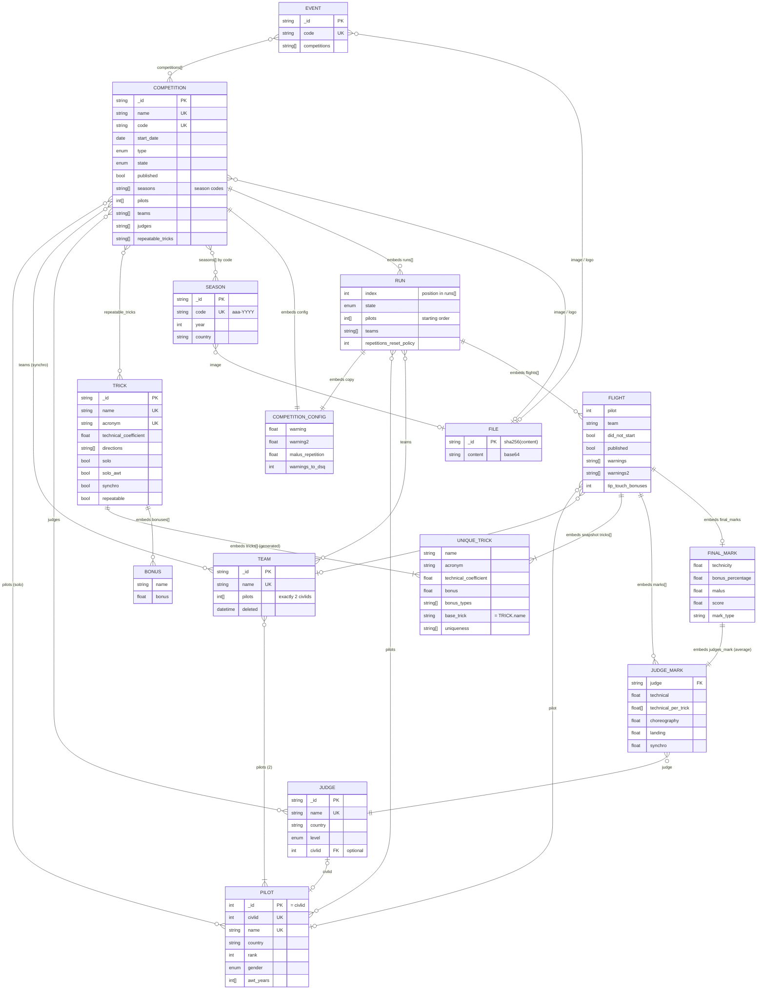
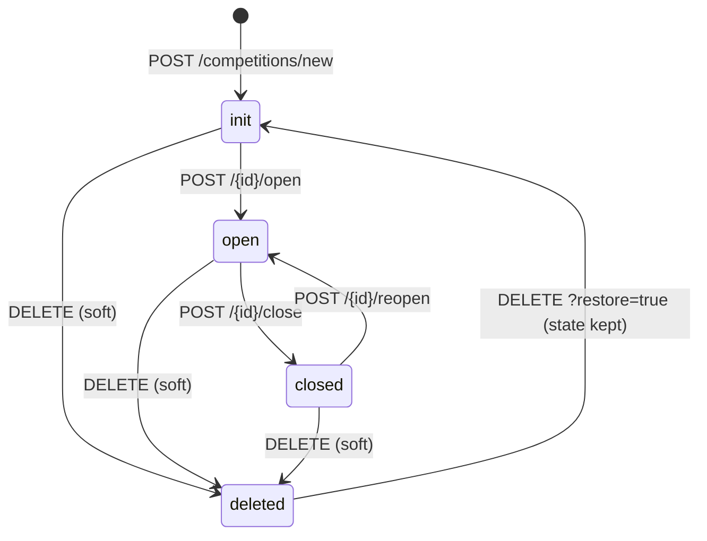
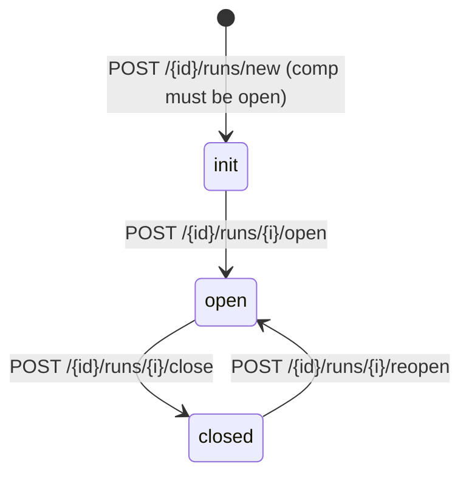

# 02 - Domain model

> Reverse-engineered from the legacy API (`api/` in the legacy repo, Python 3 / FastAPI / pydantic v2 / MongoDB via motor).
> All source references are relative to the legacy repo root (`legacy/legacy/`).
> Scoring formulas are in [03-scoring-rules.md](03-scoring-rules.md); this file covers entities, fields, storage, relationships and lifecycles.

---

## 1. Overview

The domain is a paragliding aerobatics ("acro") competition management system:

* **Pilots** (identified by their CIVL ID) fly **solo** competitions; **teams** of exactly 2 pilots fly **synchro** competitions.
* **Judges** (with a level: trainee / certified / senior) give **marks** to each **flight**.
* A **competition** contains an ordered list of **runs**; each run contains one **flight** per pilot (solo) or team (synchro).
* A flight lists the **tricks** (manoeuvres) flown. Tricks come from a **trick catalog**: each catalog entry (`Trick`) automatically expands into all its **unique tricks** (variants = direction x bonus combinations).
* A **season** (e.g. `awt-2025`, `awq-2025`, `fra-2025`) groups competitions and produces a season ranking.
* An **event** groups several competitions (e.g. a solo and a synchro comp held at the same place) for display.
* **Files** (images/logos) are stored in MongoDB as base64.

### 1.1 MongoDB collections

| Collection | Model (stored) | `_id` type | Soft delete | Unique indexes |
|---|---|---|---|---|
| `pilots` | `Pilot` | **int** = CIVL ID | no (hard delete) | `civlid`, `name` (`api/models/pilots.py:177-180`) |
| `teams` | `Team` | string (ObjectId hex) | yes (`deleted`) | `(name, deleted)` (`api/models/teams.py:88-90`) |
| `judges` | `Judge` | string (ObjectId hex) | yes | `(name, deleted)` (`api/models/judges.py:80-82`) |
| `tricks` | `Trick` (embeds `UniqueTrick[]`) | string (ObjectId hex) | yes | `(name, deleted)`, `(acronym, deleted)` (`api/models/tricks.py:175-178`) |
| `competitions` | `Competition` (embeds `Run[]` -> `Flight[]` -> `JudgeMark[]`, `FinalMark`, `UniqueTrick[]`) | string (ObjectId hex) | yes | `(name, deleted)`, `(code, deleted)` (`api/models/competitions.py:899-902`) |
| `seasons` | `Season` | string (ObjectId hex) | yes | `(name, deleted)`, `(code, deleted)` (`api/models/seasons.py:156-160`) |
| `events` | `Event` | string (ObjectId hex) | yes | `(name, deleted)`, `(code, deleted)` declared (`api/models/events.py:131-135`) but **never created** (`EventCtrl.start()` is not called in `api/main.py` lifespan) |
| `files` | `File` | string = **sha256(content)** | yes | none (natural dedup by `_id`) |

Notes on storage:

* All documents are written with `fastapi.encoders.jsonable_encoder(model)` -> ObjectIds are stored **as strings**, dates as ISO strings (`"2025-06-01"`), datetimes as ISO strings, enums as their values. Queries use `{"_id": str(id)}`.
* Soft delete = `deleted: datetime | null`. "Active" queries filter `deleted: None`. Delete/restore toggles the field; deleting an already-deleted (or restoring a non-deleted) entity is a 400 error. Pilots are the only hard-deleted entity.
* The unique indexes include `deleted`, so a name/code can be reused once the previous holder is soft-deleted (with a different `deleted` timestamp).
* `save()` methods compare the encoded document with the stored one and skip the write if identical; otherwise `update_one($set)` and 400 if `modified_count != 1` (e.g. `api/models/competitions.py:215-225`).
* Everything below the competition document (runs, flights, marks, final marks, flown tricks) is **embedded**; the competition is always loaded and saved as a whole.
* References between top-level documents are **by id (string) / CIVL ID (int)**, never DBRefs, and are not enforced by the DB (only by `check()` methods at save time).

### 1.2 Lookup conventions

| Entity | `get(id)` accepts | Source |
|---|---|---|
| Competition | `_id` **or** `code` | `api/models/competitions.py:905-919` |
| Season | `_id` or `code` | `api/models/seasons.py:162-183` |
| Event | `_id` or `code` | `api/models/events.py:137-158` |
| Trick | `_id` or `name` (catalog name, e.g. `"Misty Flip"`) | `api/models/tricks.py:181-205` |
| Unique trick | unique-trick `name` (e.g. `"twisted left Misty Flip"`) or `acronym` (e.g. `"/LM"`) | `api/models/tricks.py:220-228` |
| Judge | `_id` only; the literal `"simulator"` returns a synthetic senior judge | `api/models/judges.py:85-112` |
| Team | `_id` only | `api/models/teams.py:93-113` |
| Pilot | CIVL ID (int); ids `< -999999` return a synthetic "simulator" pilot; `-999999..0` -> 404 | `api/models/pilots.py:107-141` |
| File | `_id` (sha256) | `api/models/files.py:62-81` |

---

## 2. Entity reference

Legend: **R** = required, **O** = optional, default in the Default column. "Stored" = persisted fields; "Export" models are response-only (section 4).

### 2.1 Pilot (`pilots` collection) — `api/models/pilots.py:34-49`

Pilots are imported from the CIVL website (scraping, `api/controllers/pilots.py:174-286`); there is no free-form creation API (creation = "import CIVL ID").

| Field | Type | R/O | Default | Rules / notes |
|---|---|---|---|---|
| `_id` (alias of `id`) | int | R | — | Equals `civlid`. |
| `civlid` | int | R | — | CIVL pilot id. Unique index. |
| `name` | str | R | — | Full name "First Last" (xlsx export splits on the first space). Unique index. |
| `civl_link` | HttpUrl | R | — | Link to CIVL page. |
| `country` | str | R | — | Lower-case ISO-3166 alpha-3 extracted from the CIVL flag css class (`flag-xxx`). **Not validated.** Used for country sub-rankings. |
| `about` | str | R | — | Free text. |
| `social_links` | `Link[]` | R | — | `Link = {name: str, link: HttpUrl}`. |
| `sponsors` | `Sponsor[]` | R | — | `Sponsor = {name: str, link: HttpUrl?, img: str}`. |
| `photo` | HttpUrl | R | — | |
| `photo_highres` | HttpUrl | O | null | |
| `background_picture` | HttpUrl | R | — | |
| `last_update` | datetime | O | null | Set to `now()` on every `save()`. |
| `rank` | int | R | — | CIVL world ranking (aerobatic solo). **9999 = unranked.** Used to sort the competition pilot list (starting order of run 1). Refreshed by `update_rankings()`. |
| `gender` | enum `GenderEnum` | O | `man` | `man` / `woman` / `none`. Toggled man<->woman by `PATCH /pilots/{civlid}/gender` (`none` stays `none`). Not provided by CIVL; preserved across CIVL re-imports. |
| `awt_years` | int[] | O | `[]` | Years in which the pilot is an **AWT** (Acro World Tour) pilot; otherwise he is **AWQ** (qualifier) for that year. Toggled per year by `PATCH /pilots/{civlid}/awt?year=`. Preserved across CIVL re-imports. |

Derived: `is_awt(year) = year in awt_years` (`api/models/pilots.py:103-104`; NB the default `year` argument is evaluated once at import time). In competitions the year used is always `competition.start_date.year`.

Synthetic simulator pilot (`api/models/pilots.py:108-122`): for `id < -999999`, name `"simulator {id}"`, country `fra`, rank 9999, `awt_years=[current year]` if id even else `[0]`.

### 2.2 Team (`teams`) — `api/models/teams.py:22-51`

| Field | Type | R/O | Default | Rules |
|---|---|---|---|---|
| `_id` | str (ObjectId) | R | generated | |
| `name` | str | R | — | Unique among non-deleted (index `(name, deleted)`). |
| `pilots` | int[] | R | — | **Exactly 2** CIVL IDs (validator, `teams.py:28-33`); each must exist as a Pilot (`check()`, `teams.py:44-51`). Duplicate pilot inside a team is not rejected. |
| `deleted` | datetime | O | null | Soft delete. |

### 2.3 Judge (`judges`) — `api/models/judges.py:24-54`

| Field | Type | R/O | Default | Rules |
|---|---|---|---|---|
| `_id` | str (ObjectId) | R | generated | |
| `name` | str | R | — | min length 2; unique among non-deleted. |
| `country` | str | R | — | Must be a valid ISO alpha-3 code (pycountry lookup, case-insensitive; value stored as given). |
| `level` | enum `JudgeLevel` | R | — | `trainee` / `certified` / `senior`. Drives the judge's weight in averages (see scoring). |
| `civlid` | int | O | null | If set, must exist in `pilots` (`check()`). |
| `deleted` | datetime | O | null | |

Listing order: `level DESC, name ASC` (string order: trainee > senior > certified).

### 2.4 Trick catalog (`tricks`) — `api/models/tricks.py:18-110`

#### 2.4.1 `Bonus` (embedded value object)

| Field | Type | R/O | Rules |
|---|---|---|---|
| `name` | str | R | min length 1; must be one of the configured bonus names (table 2.4.4). |
| `bonus` | float | R | `>= 0`; percentage (e.g. `2.5` = +2.5 %). |
| `sample_video` | AnyHttpUrl | O | |

#### 2.4.2 `Trick` (stored)

| Field | Type | R/O | Default | Rules / meaning |
|---|---|---|---|---|
| `_id` | str | R | generated | |
| `name` | str | R | — | min length 1, unique (with `deleted`). Name **without** direction/bonus, e.g. `"Misty Flip"`. Also the `base_trick` of all its variants. |
| `acronym` | str | R | — | min length 1, unique (with `deleted`). Without direction/bonus, e.g. `"M"`. |
| `types` | str[] | O | `[]` | Free tags; `"tumbling"` and `"to infinite"` are limited per run (see scoring). |
| `solo` | bool | R | — | Allowed in solo. |
| `solo_awt` | bool | O | `true` | Allowed for AWT pilots in AWT-season solo comps. |
| `synchro` | bool | R | — | Allowed in synchro. |
| `directions` | str[] | R | — | Either `[]` (no direction) or **>= 2 distinct** values among `right`, `left`, `opposite` (validator `tricks.py:87-102`). |
| `technical_coefficient` | float | R | — | `>= 0`. Difficulty coefficient (e.g. 1.65). |
| `bonuses` | `Bonus[]` | R | — | Bonuses that can be combined on this trick. |
| `bonus_constraints` | `str[2][]` | O | `[]` | Pairs of bonus names that are mutually exclusive; each inner list must have exactly 2 entries. |
| `tricks_constraints` | str[] | O | `[]` | "Tricks that cannot be performed during the same competition". **Never used** (dead field). |
| `first_maneuver` | int | O | 0 | `>= 0`. If > 0: must be within the first N tricks of the run (else warning). |
| `no_first_maneuver` | int | O | 0 | If > 0: must not be within the first N tricks. |
| `last_maneuver` | int | O | 0 | If > 0: must be within the last N tricks. **Logic is inverted in the code**, see 03 open questions. |
| `no_last_maneuver` | int | O | 0 | If > 0: must not be within the last N tricks. |
| `tricks` | `UniqueTrick[]` | O | `[]` | **Generated** server-side on create/import/update (client value ignored), see 2.4.5. |
| `repeatable` | bool | O | false | Default membership of a new competition's `repeatable_tricks` list. |
| `deleted` | datetime | O | null | |
| `sample_video` | AnyHttpUrl | O | null | |

Extra JSON fields present in the import files (`description`, `criterias`) are silently dropped.
Real catalogs are in `import/2022..2025/tricks/*.json` (≈ 55 tricks in 2025).

#### 2.4.3 `UniqueTrick` (embedded in `Trick.tricks` and copied into `Flight.tricks`) — `api/models/tricks.py:38-63`

| Field | Type | R/O | Default | Meaning |
|---|---|---|---|---|
| `name` | str | R | — | Full variant name, e.g. `"twisted left Misty to Helicopter reverse"`. |
| `acronym` | str | R | — | Full variant acronym, e.g. `"/LMHR"`. Must be globally unique (checked only by the `check_tricks_unicity` helper). |
| `technical_coefficient` | float | R | — | Copied from the parent trick. |
| `bonus` | float | R | — | **Sum** of the bonuses of the combination (%). |
| `bonus_types` | str[] | R | — | Distinct bonus **types** of the combination (`twist`, `reverse`, `flip`, `other`), in combination order. |
| `base_trick` | str | R | — | Parent trick **name**. |
| `uniqueness` | str[] | R | — | Identity used for **repetition** detection: `["reverse"]` if a reverse bonus is present, plus the direction (`left`/`right`/`opposite`). Twists are **not** part of it (`/LM` and `LM` are "the same trick"). |
| `bonuses` | `Bonus[]` | O | `[]` | The combination. |
| `synchro` | bool | O | null | Copied. |
| `solo` | bool | O | null | Copied; **false for `opposite` variants** auto-generated for solo+synchro tricks. |
| `solo_awt` | bool | O | null | Copied. |
| `types` | str[] | O | `[]` | Copied. |
| `technical_mark` | float | O | null | Set during AWT scoring (weighted per-trick technical mark); persisted in the flight. |
| `technical_marks` | dict[judgeId, float] | O | null | Set during AWT/AWQ scoring (per-judge per-trick marks); persisted in the flight. |

#### 2.4.4 Configured bonuses and directions (code constants) — `api/core/config.py:33-55`

| Bonus name | Acronym part | Position | Type |
|---|---|---|---|
| `reverse` | `R` | suffix | reverse |
| `twisted` | `/` | **prefix** | twist |
| `twisted exit` | `/` | suffix | twist |
| `full twisted` | `\` | suffix | twist |
| `devil twist` | `X` | suffix | twist |
| `devil twist stall` | `XX` | suffix | twist |
| `to twisted sat` | `S` | suffix | twist |
| `cab slide` | `C` | suffix | twist |
| `hardcore` (legacy, to be migrated) | `HC` | suffix | twist |
| `hardcore entry` | `HC` | suffix | twist |
| `flip` | `F` | suffix | flip |
| `double flip` | `FF` | suffix | flip |
| `wing touch` | `T` (first definition wins; a second `WT` entry is unreachable) | suffix | other |

| Direction | Acronym |
|---|---|
| `right` | `R` |
| `left` | `L` |
| `opposite` | `O` |

#### 2.4.5 Variant generation — `api/controllers/tricks.py:14-143`

```
combinations = []
for k in 1..len(bonuses):
  for combo in itertools.combinations(bonuses, k):        # catalog order preserved
     if any pair (a,b) of combo (sorted names) equals a sorted bonus_constraint: skip combo
     else combinations.append(combo)
variants = [generate([])] + [generate(c) for c in combinations]

generate(combo):
  bonus       = sum(b.bonus for b in combo)
  bonus_types = distinct(type(b) for b in combo)          # order of first appearance
  pre_name    = " ".join(names of prefix bonuses) ; pre_acr  = concat(prefix acronyms)
  post_name   = " ".join(names of suffix bonuses) ; post_acr = concat(suffix acronyms)
  name     = [pre_name " "] + [direction " "] + trick.name + [" " post_name]
  acronym  = pre_acr + [direction_acronym] + trick.acronym + post_acr
  uniqueness = ["reverse"] if "reverse" in bonus_types else []
  if directions == []: one variant, uniqueness as is
  else: one variant per direction (uniqueness + [direction]);
        if trick.solo and trick.synchro: one extra "opposite" variant with solo=False
```

Example (Misty Flip, `M`, 1.65, directions left/right, bonuses twisted 2.5 / twisted exit 3.5 / full twisted 6, constraints [twisted, full twisted], [twisted exit, full twisted]):
`LM, RM, OM(solo=false), /LM(2.5), /RM, /OM, LM/(3.5), RM/, OM/, LM\(6), RM\, OM\, /LM/(6.0), /RM/, /OM/`.

Generation runs on `POST /tricks/new`, `POST /tricks/import` and `PUT /tricks/{id}`. **Existing flights keep their own copy** of the unique trick (coefficient/bonus at the time of the flight), so catalog edits never change stored scores until the flight is re-saved.

### 2.5 Competition (`competitions`) — `api/models/competitions.py:96-159`

#### 2.5.1 Enums

| Enum | Values | Source |
|---|---|---|
| `CompetitionType` | `solo`, `synchro` | `competitions.py:32-34` |
| `CompetitionState` | `init`, `open`, `closed` | `competitions.py:36-39` |

#### 2.5.2 `CompetitionNew` (creation / update payload) and `Competition` (stored)

| Field | Type | R/O | Default | Rules / notes |
|---|---|---|---|---|
| `_id` | str | R | generated | stored only |
| `name` | str | R | — | `Field(min_len=1)` is **not enforced** in pydantic v2 (empty accepted). Unique among non-deleted. Immutable once state != `init`. |
| `code` | str | O | slug of name | Pattern `^[a-z][a-z0-9-]*[a-z0-9]` (anchored at start only, >= 2 chars). If null at creation: `name` -> NFD -> ASCII -> lower -> drop `[^a-z0-9 ]` -> strip -> spaces to `-` (`competitions.py:113-114`; e.g. `"Coupe Icare 2025 – Acro Élite!"` -> `coupe-icare-2025--acro-elite`). Unique among non-deleted. Immutable once state != `init`. Used in URLs. |
| `start_date` | date | R | — | `start_date <= end_date` (`check()`). `start_date.year` defines AWT/AWQ status of pilots. |
| `end_date` | date | R | — | |
| `location` | str | R | — | min length not enforced. |
| `published` | bool | R | — | Unpublished competitions are hidden from public endpoints. |
| `type` | `CompetitionType` | R | — | Immutable once state != `init`. |
| `image` | str | O | null | File id (on update, only the last path segment of the provided URL is kept). Exported as `/files/{id}`. |
| `logo` | str | O | null | Same as image. |
| `website` | AnyHttpUrl | O | null | |
| `seasons` | str[] | O | `[]` | Season **codes** (not ids). Not validated against `seasons`. Drives sub-rankings (see scoring). |
| `last_update` | datetime | O | null | Set to the flight's `last_update` on each flight save. |
| `pilots` | int[] | O | `[]` | Solo only. CIVL IDs; must exist; no duplicates. **Re-sorted by `rank` descending (worst-ranked first) at every save** (`check()`, `competitions.py:162-176`). This order = starting order of run 1. |
| `teams` | str[] | O | `[]` | Synchro only. Team ids; must exist; no duplicates. Order kept as given. |
| `judges` | str[] | O | `[]` | Judge ids; must exist. |
| `repeatable_tricks` | str[] | O | ids of all tricks with `repeatable=true` at creation | Trick ids (or names) exempt from repetition malus. **This competition-level list is the one used for scoring.** |
| `state` | `CompetitionState` | R | `init` | |
| `config` | `CompetitionConfig` | R | defaults | See 2.6. Copied into each run at run creation. |
| `runs` | `Run[]` | R | `[]` | Embedded, ordered (index 0 = "run 1"). |
| `deleted` | datetime | O | null | |

`check()` (run on every create/save, `competitions.py:161-201`):

| Rule | Error |
|---|---|
| Solo: every pilot exists | 400 `Pilot 'x' is unknown...` (in practice `Pilot.get` raises 404 first) |
| Solo: no duplicate pilots | 400 |
| Synchro: every team exists, no duplicates | 400 |
| Every judge exists | 400 / 404 |
| If `state != init`: solo needs >= 2 pilots, synchro >= 2 teams, and >= 2 judges | 400 `At least 2 ... are needed to open a competition` |
| `start_date <= end_date` | 400 |

Because `check()` runs on every save, a competition that is open/closed can never be saved with fewer than 2 pilots/teams/judges (this blocks e.g. removing judges).

### 2.6 CompetitionConfig (embedded in Competition and in each Run) — `api/models/competition_configs.py:7-83`, defaults from `api/core/config.py:57-78`

| Field | Type | Default | Meaning |
|---|---|---|---|
| `warning` | float | **0.5** | Points deducted per category-1 warning. |
| `warning2` | float | **1** | Points deducted per category-2 warning. |
| `malus_repetition` | float | **13** | % malus per repeated trick (applied to the bonus %). |
| `warnings_to_dsq` | int | **3** | Total warnings (cat1 + cat2) in the competition leading to DSQ. |
| `judge_weights.senior` | int | **100** | Weight of a senior judge. |
| `judge_weights.certified` | int | **100** | Weight of a certified judge. |
| `judge_weights.trainee` | int | **20** | Weight of a trainee judge. |
| `mark_percentages.solo.technical` | int | **40** | % of technical in solo score. |
| `mark_percentages.solo.choreography` | int | **40** | |
| `mark_percentages.solo.landing` | int | **20** | |
| `mark_percentages.synchro.technical` | int | **20** | (The OpenAPI example says 25 — the code default is 20.) |
| `mark_percentages.synchro.choreography` | int | **20** | |
| `mark_percentages.synchro.landing` | int | **20** | |
| `mark_percentages.synchro.synchro` | int | **40** | |
| `max_bonus_per_run.twist` | int | **5** | Max tricks carrying a `twist` bonus type counted in a run. |
| `max_bonus_per_run.reverse` | int | **3** | |
| `max_bonus_per_run.flip` | int | **2** | (OpenAPI example says 1 — code default is 2.) |

Not configurable per competition (global constants): `max_tricks_per_type = {"tumbling": 2, "to infinite": 1}` (`api/core/config.py:75-78`), tip-touch bonus 2 %/touch capped at 6 % (hard-coded), default max for an unknown bonus type = 10 (hard-coded).

No validation on percentages summing to 100, nor on positivity.

### 2.7 Run (embedded in `Competition.runs[]`) — `api/models/runs.py:22-70`

| Field | Type | R/O | Default | Notes |
|---|---|---|---|---|
| `state` | `RunState` | R | `init` | `init` / `open` / `closed`. |
| `pilots` | int[] | R | — | Solo: participants **in starting order**. `min_len` not enforced. Empty for synchro. |
| `teams` | str[] | R | — | Synchro participants in starting order. Empty for solo. |
| `judges` | str[] | R | — | Copied from comp at creation; editable; **not used for scoring nor validation of marks**. |
| `repeatable_tricks` | str[] | R | — | Copied from comp; editable; **not used by scoring** (scoring uses the competition-level list). |
| `config` | `CompetitionConfig` | R | — | **Copied** from comp at creation; **this** config is used to score flights of the run. |
| `flights` | `Flight[]` | R | `[]` | One per pilot/team (upsert by participant). Order = order of first save. |
| `repetitions_reset_policy` | `RunRepetitionsResetPolicy` (int) | O | `0` | `0 none`, `1 awt`, `2 awq`, `3 all`: from this run on, tricks flown in earlier runs no longer cause a repetition malus (for all pilots / AWT pilots only / AWQ pilots only). Set at creation only. |
| `last_update` | datetime | O | null | Set on each flight save. |

Runs have **no id**: they are addressed by their index `i` (0-based) in URLs.

### 2.8 Flight (embedded in `Run.flights[]`) — `api/models/flights.py:33-102`

`FlightNew` = input payload (`POST /competitions/{id}/runs/{i}/flights/{pilot_or_team}/new?save=&published=&mark_type=`).

| Field | `FlightNew` | `Flight` (stored) | Default | Notes |
|---|---|---|---|---|
| `pilot` | — | int, R | — | CIVL ID (solo); `0` for synchro. |
| `team` | — | str, O | null | Team id (synchro); `""` for solo. |
| `tricks` | str[] (unique-trick names or acronyms) | `UniqueTrick[]` | — | Resolved at save; unknown -> 400 `Unknown trick(s): ...`. Order = flown order. Snapshot of the catalog. |
| `marks` | `JudgeMark[]` | `JudgeMark[]` | — | One per judge (not enforced). |
| `did_not_start` | bool | bool | false | DNS: score 0. |
| `warnings` | str[] | str[] | `[]` | **Category-1** warnings entered by the operator (free text). Only these (not auto-generated ones) count as "previous warnings" in later runs. |
| `warnings2` | str[] | str[] | `[]` | **Category-2** warnings. |
| `tip_touch_bonuses` | int | int | 0 | Synchro only: number of tip touches. Note: the manager UI never sends it for solo/AWT/AWQ tabs. |
| `final_marks` | — | `FinalMark`, O | null | Computed score (see 2.10). |
| `published` | — | bool | false | Published flights appear in public run results. |
| `last_update` | — | datetime, O | null | `now()` at save. |

### 2.9 JudgeMark (embedded in `Flight.marks[]`, and as `FinalMark.judges_mark`) — `api/models/marks.py:33-67`

| Field | Type | R/O | Default | Rules |
|---|---|---|---|---|
| `judge` | str | R | — | Judge id (`"simulator"` allowed). Not checked against the comp/run judge list. In `FinalMark.judges_mark` it is `""`. |
| `technical` | float | O | null | `>= 0`, rounded to 3 decimals on validation. Required (by at least one judge) unless `mark_type` is `awt`/`awq`. |
| `technical_per_trick` | (float \| null)[] | O | null | One entry per flown trick (AWT/AWQ marking). `null` entries are filled with the plain average of the other judges for that trick. Not rounded. |
| `choreography` | float | O | null | `>= 0`, rounded to 3 d. |
| `landing` | float | O | null | `>= 0`, rounded to 3 d. |
| `synchro` | float | O | null | `>= 0`, rounded to 3 d. Synchro only. |

No upper bound (10) is validated. **Pydantic quirk**: a field *omitted* stays `null` (= "no mark"), but a field *explicitly sent as `null`* goes through the rounding validator which returns **0** (= a mark of 0 that counts in the averages).

### 2.10 FinalMark (embedded as `Flight.final_marks`) — `api/models/marks.py:98-143`

| Field | Type | Constraint | Meaning |
|---|---|---|---|
| `judges_mark` | `JudgeMark` | | Weighted average of judges' marks (`judge=""`), choreography possibly lowered by 1 (direction rule). |
| `technicity` | float | `>= 0` | Average of the 3 best coefficients (padded with 1.0). |
| `bonus_percentage` | float | | Sum of trick bonuses (+ tip touch), in %. |
| `technical` | float | `>= 0` | Technical component (points). |
| `choreography` | float | `>= 0` | |
| `landing` | float | `>= 0` | |
| `synchro` | float | `>= 0` | |
| `bonus` | float | (may be negative) | Bonus points (after repetition malus). |
| `score` | float | `>= 0` | Final flight score. |
| `warnings` | str[] | | Cat-1 warnings of this flight **plus auto-generated position warnings**. |
| `warnings2` | str[] | | Cat-2 warnings. |
| `malus` | float | `>= 0` | Repetition malus in % (13 x n). |
| `notes` | str[] | | Human-readable explanations (DSQ, ignored tricks, malus, penalties...). |
| `mark_type` | str | O | `null` (classic), `"awt"`, `"awq"` — which marking scheme was used. |

All float fields are rounded to 3 decimals **when the model is validated** (i.e. when loaded from MongoDB or exported), not at computation time — see 03 §9.

### 2.11 Season (`seasons`) — `api/models/seasons.py:99-139`

| Field | Type | R/O | Default | Rules |
|---|---|---|---|---|
| `_id` | str | R | generated | |
| `name` | str | R | — | min length 2; unique among non-deleted. |
| `code` | str | R | — | Pattern `^[a-z]{3}-[0-9]{4}$`. Must end with `-{year}`; if `country` set it is **forced** to `{country}-{year}`. Unique. Competitions reference seasons by this code. Prefix semantics: `awt-` (Acro World Tour: AWT pilots), `awq-` (qualifier: non-AWT pilots), any other 3 letters = **country filter** (`fra-2025` keeps pilots with `country == "fra"`). |
| `year` | int | R | — | `> 1900`. |
| `image` | str | O | null | File id; exported as `/files/{id}`. |
| `image_url` | str | O | null | Computed on read (`/files/{image}`); also ends up stored. |
| `country` | str | O | null | Pattern `^[a-z]{3}`, valid ISO alpha-3. Marks a national championship season. |
| `index` | int | O | 999 | Display ordering hint. |
| `deleted` | datetime | O | null | |

A season has no stored link to competitions: membership = competitions whose `seasons[]` contains the season code. All competitions of a season must have the same `type` (else HTTP 500 at export). The season `type` is derived (solo if no competition).

### 2.12 Event (`events`) — `api/models/events.py:44-81`

| Field | Type | R/O | Default | Rules |
|---|---|---|---|---|
| `_id` | str | R | generated | |
| `name` | str | R | — | min length 2 |
| `code` | str | R | — | min length 2 |
| `start_date`, `end_date` | date | R | — | no ordering check |
| `country` | str | R | — | valid ISO alpha-3 |
| `location` | str | R | — | min length 2 |
| `website` | AnyHttpUrl | O | null | |
| `description` | str | O | null | |
| `image`, `logo` | str | O | null | File ids |
| `streaming_url` | AnyHttpUrl | O | null | |
| `competitions` | str[] | O | `[]` | Competition ids or codes; each must exist and be non-empty. |
| `deleted` | datetime | O | null | |

### 2.13 File (`files`) — `api/models/files.py:22-37`

| Field | Type | R/O | Rules |
|---|---|---|---|
| `_id` | str | O | = `sha256(content).hexdigest()` computed at creation (content-addressed; re-upload of the same content updates the existing doc). |
| `filename` | str | R | min 1 |
| `content_type` | str | R | min 1 (MIME type from upload) |
| `content` | str | R | **base64** of the binary. Served decoded at `/files/{id}`. |
| `deleted` | datetime | O | |

### 2.14 Cache (not persisted) — `api/models/cache.py`

A **per-request in-memory memo** (one `Cache()` instance per HTTP request) holding already-loaded pilots, teams, judges, tricks, competitions, seasons, files, and "get all" lists. Lookup keys: id, name, code or acronym depending on type. It has no persistence and no invalidation; it is purely an optimisation and **not part of the domain** (a rewrite may drop it). A Redis dependency is imported in `api/main.py` but unused.

### 2.15 Value objects for results (computed, never stored)

| Model | Fields | Source |
|---|---|---|
| `RunResults` | `final: bool`, `type: str`, `results: dict[str, Flight[]]` (keys: `overall`, season codes, `women`), `last_update` | `api/models/results.py:29-53` |
| `RunResultSummary` | `rank: int`, `score: float` (3 d.) | `results.py:55-65` |
| `CompetitionPilotResults` | `pilot: int` (0 for synchro), `team: str` (`""` for solo), `result_per_run: RunResultSummary[]`, `score: float` (3 d.) | `results.py:76-117` |
| `CompetitionResults` | `final`, `type`, `results: dict[str, CompetitionPilotResults[]]`, `runs_results: RunResults[]` | `results.py:128-166` |
| `SeasonResult` | `pilot?: Pilot`, `team?: TeamExport`, `score: float` (not rounded) | `seasons.py:31-37` |
| `SeasonResults` | `type: "overall" \| "women"`, `results: SeasonResult[]` | `seasons.py:39-44` |
| `PilotWithResults` | Pilot + `competitions_results: {competition: CompetitionPublicExport, rank}[]` + `seasons_results: {season: Season, rank}[]` | `api/models/pilots_with_results.py:20-102` |
| `SvgData` | `rank`, `country?`, `name`, `score` | `api/models/svg_data.py` |
| `Status` | `project`, `version` | `api/models/status.py` |

---

## 3. Relationships



Referential integrity summary:

| Reference | Checked when | Not checked |
|---|---|---|
| Competition.pilots/teams/judges | every comp save | at delete of the referenced entity (a deleted team/judge stays referenced) |
| Team.pilots | team save | pilot hard delete (the "delete unused pilots" utility only deletes pilots referenced by no competition, team, or judge) |
| Judge.civlid | judge save | |
| Competition.seasons | never | unknown season code = silently ignored except for sub-rankings |
| Event.competitions | event save | |
| JudgeMark.judge | at scoring: must exist (404 otherwise) | must belong to the comp / run judge list |
| Run.pilots vs Competition.pilots | flight save/get: pilot must be in **both** lists | |

---

## 4. Stored vs export (response) models

| Domain entity | Stored model | Export / response models | Differences |
|---|---|---|---|
| Pilot | `Pilot` | `Pilot` (same), `PilotWithResults` | +computed competition/season ranks |
| Team | `Team` (pilots = civlids) | `TeamExport` (`_id`, `name`, `pilots: Pilot[]`) | pilots expanded, no `deleted` |
| Judge | `Judge` | `Judge` | — |
| Trick | `Trick` | `Trick`; public `/tricks/unique` returns `UniqueTrick[]` | — |
| Competition | `Competition` | `CompetitionExport` (admin: full, pilots/teams/judges/repeatable_tricks expanded, runs as `RunExport`, `image`/`logo` as `/files/{id}`), `CompetitionPublicExport` (summary with `number_of_pilots/teams/judges/runs`, no runs), `CompetitionPublicExportWithResults` (summary + pilots/teams/judges + `results: CompetitionResultsExport` with judges' individual marks stripped) | `deleted`, `config` hidden in public exports |
| Run | `Run` | `RunExport` (participants/judges/tricks expanded, flights as `FlightExport`) | |
| Flight | `Flight` | `FlightExport` (`pilot: Pilot?`, `team: TeamExport?`, `marks: JudgeMarkExport[]`, `final_marks: FinalMarkExport`) | references expanded |
| JudgeMark | `JudgeMark` | `JudgeMarkExport` (`judge: Judge?`) | judge expanded; validators round to 3 d. |
| FinalMark | `FinalMark` | `FinalMarkExport` | same fields, rounding to 3 d. |
| Results | (never stored) | `RunResultsExport`, `CompetitionResultsExport` (`CompetitionPilotResultsExport` with expanded pilot/team), `SeasonResults` | export re-sorts competition results by `(-score, name)` |
| Season | `Season` | `SeasonExport` (admin: + competitions `CompetitionExport[]` + results), `SeasonExportLight` (counts), `SeasonPublicExport` (+ `competitions: CompetitionPublicExportWithResults[]`, `results: SeasonResults[]`, `competitions_results: {compCode: CompetitionPilotResultsExport[]}`) | |
| Event | `Event` | `EventExport` (`image_url`, `logo_url` (bug: built from `image`), `competitions: CompetitionPublicExport[]`) | |
| File | `File` | raw bytes at `/files/{id}`, `FileID` on upload | |

---

## 5. Lifecycles and state machines

### 5.1 Competition



| Transition / operation | Precondition | Source |
|---|---|---|
| create | name/code unique among non-deleted; `check()` (state = init so participant counts not checked); `runs=[]`, `config=defaults`, `repeatable_tricks = all repeatable tricks` | `competitions.py:111-138, 203-213` |
| `open` | state == `init`; then save -> `check()` requires >= 2 pilots (solo) / teams (synchro) and >= 2 judges | `competitions.py:427-432` |
| `close` | state == `open` **and every run is `closed`** (error lists run indexes) | `competitions.py:434-443` |
| `reopen` | state == `closed` | `competitions.py:445-450` |
| update (`PATCH /{id}`) | state != `closed`; `name`, `code`, `type` changeable only in `init` | `competitions.py:358-387` |
| update pilots / teams / judges / repeatable tricks / config | state != `closed`; pilots only for solo, teams only for synchro | `competitions.py:389-425` |
| new run | state == `open` | `competitions.py:464-526` |
| delete / restore | soft delete; restore keeps the previous state | `competitions.py:944-959` |

Run-level operations (`run_update_*`, `run_open/close/reopen`, flight save/delete) **do not check the competition state** — e.g. a flight can be re-saved in a closed competition.

"Final" flag of results: `competition.state == closed` **and** every run's results are final (see 5.2).

### 5.2 Run



| Transition | Precondition | Source |
|---|---|---|
| create | comp `open`; participants computed (see 03 §8.1); `judges`, `config`, `repeatable_tricks` copied from comp; optional `pilots_to_qualify` (keep first N of the computed list) and `repetitions_reset_policy` | `competitions.py:464-526` |
| `open` | state == `init` | `competitions.py:568-576` |
| `close` | state == `open`; **every participant of `run.pilots`/`run.teams` has a flight**, and **every such flight is published** (errors list participant names, falling back to the id) | `competitions.py:578-601`, tests `api/tests/test_close.py` |
| `reopen` | state == `closed` | `competitions.py:615-623` |
| update pilots/teams/judges/repeatable tricks/config | none (any state) | `competitions.py:534-566` |

There is no run deletion API.

Run results are `final` iff `run.state == closed` **and** all its flights are published (`competitions.py:655`).

### 5.3 Flight

Flights have no explicit state machine; they are upserted:

| Operation | Behaviour | Source |
|---|---|---|
| Simulate (`save=false`) | Computes and returns the `FinalMark` without persisting. | `competitions.py:718-741` |
| Save (`save=true&published=bool`) | Participant must be in the run **and** in the competition. Tricks resolved; score computed; `final_marks`, `published`, `last_update` set; replaces the existing flight of the same pilot/team in place, else appended. Also sets `run.last_update` and `competition.last_update`. **No check on run state.** | `competitions.py:718-760` |
| Get / delete | By run index and pilot/team id; same participation checks. | `competitions.py:659-684` |

Implicit flight states: *absent* -> *saved unpublished* -> *saved published* (and back: re-saving with `published=false` unpublishes).

Since each save recomputes only the saved flight, **scores of later runs are not recomputed** when an earlier flight changes (repetition malus, previous warnings and DSQ depend on earlier runs). Operators must re-save later flights manually.

**Rewrite** (controller rulings, Task 21 judging screen):
* A flight is saved or deleted only in an open run of a non-frozen competition; both rescore the participant's later flights and rebuild the stored rankings in the same transaction.
* Optimistic concurrency: a flight has a `version` (1 at creation, +1 on every save of its input; rescoring does not change it). A save or delete quotes the version the form was loaded from (none for a new flight, which must not exist yet) and is refused with a conflict ("This flight was changed by someone else — reload to see it") when it no longer matches.
* Stored judge marks are the marks **as entered**: a blank per-trick technical mark stays `null` in `technical_per_trick`. The engine fills it in (spec 03 §5.0 step 4) at every scoring; the filled values live only in the final mark and in the flight tricks' `technical_marks`. Flights imported from legacy keep the marks as legacy stored them.

### 5.4 Other entities

| Entity | Lifecycle |
|---|---|
| Pilot | Created/updated by CIVL import (`POST /pilots/{civlid}` / sync jobs; upsert by `_id`); `rank` refreshed by "update rankings" (unranked -> 9999); gender & AWT years toggled manually; hard delete. |
| Team / Judge / Trick / Season / Event / File | create -> update -> soft delete <-> restore. Trick update regenerates variants. Season save forces the code when `country` is set. |

---

## 6. Identifiers summary

| Entity | Business identifier used by clients | Technical id |
|---|---|---|
| Pilot | CIVL ID | same |
| Team | — | ObjectId string |
| Judge | — | ObjectId string |
| Trick | `name` / `acronym` | ObjectId string |
| Unique trick | `acronym` (also `name`) — this is what operators type | none (embedded) |
| Competition | `code` (slug) | ObjectId string |
| Run | index in `runs[]` (0-based; UI shows i+1) | none |
| Flight | (competition, run index, pilot CIVL ID or team id) | none |
| Season | `code` (`aaa-YYYY`) | ObjectId string |
| Event | `code` | ObjectId string |
| File | sha256 of base64 content | same |
