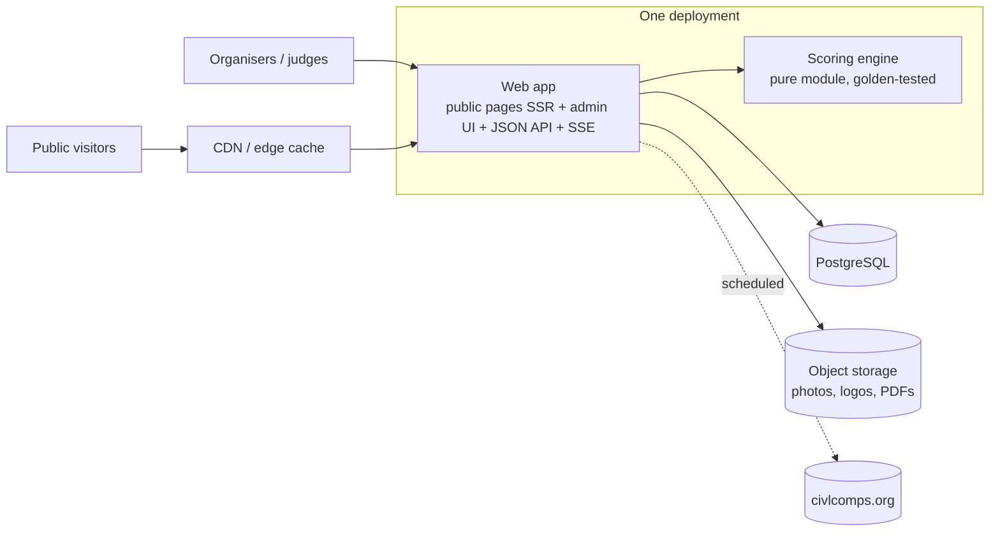
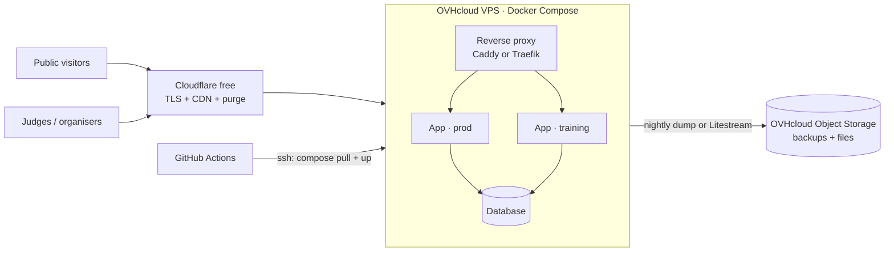

# 08 — Rewrite recommendations

This file consolidates the findings of documents 01 to 07 into decisions and a target. It is a proposal: sections marked **Decision** need the owner's input before development starts.

## 1. Goals

| Goal | What it means concretely |
|---|---|
| Simpler | One backend, one database, one front-end codebase (public + admin), one hosting provider. No dead code paths (`public2`, events router, Redis, render mirror). |
| Easier to maintain | Typed domain model; scoring engine as a pure, tested module; rule constants versioned per season instead of hard-coded; content editable without writing HTML. |
| Easier to deploy | One container (or one binary) + one database; CI that tests then deploys; preview/training environment deployed *before* prod. |
| Much faster | Results computed on write and stored, public pages server-rendered and cached at the edge, live updates pushed (SSE) instead of polled or cached for a minute. |

## 2. Decisions to make before coding

### 2.1 Legacy scoring quirks: reproduce or fix?

Recommended rule: **historical competitions keep their stored `final_marks` as-is** (they are official results, already sent to CIVL). The new engine only scores new flights, so fixing a bug does not change past results. Golden tests compare the new engine with the legacy engine only on the paths that are not being changed.

| # | Legacy behaviour (03 §14) | Recommendation |
|---|---|---|
| 1 | `pilots_to_qualify` keeps the N **worst** pilots | Fix: keep the N best. Confirm how operators use it today. |
| 2 | Creating run n re-sorts run n−1's stored starting order | Fix. |
| 3–4 | Per-run ranks in the overall table are inverted or overwritten by sub-ranking ranks | Fix: store rank per ranking list. |
| 5 | Unpublished flights count in public competition totals | **Decision.** Recommend: public views use published flights only. |
| 6 | `last_maneuver` check inverted | Fix (unused in 2025 catalog). |
| 7 | Warning penalty is cumulative (each new warning re-deducts earlier ones) | **Decision**: check against 7B §7.2.2. |
| 8 | Automatic position warnings don't count toward later DSQ | **Decision**: check against 7B. |
| 9, 14 | Editing an earlier flight doesn't rescore later runs; reset policy scans future runs | Fix: rescore all dependent flights of the pilot/team on every save. |
| 12 | Explicit `null` mark becomes 0 and is averaged in | Fix: `null` = no mark. |
| 13 | No 0–10 range check on marks | Fix. |
| 15 | Flights can be saved in closed runs/competitions | Fix: enforce run state (with an explicit "reopen"). |
| 16 | Position rules read the *current* catalog, coefficients come from the flight snapshot | Fix: everything from a per-season catalog snapshot. |
| 18 | Synchro percentages 20/20/20/40 vs documented 25/25/25/25 | **Decision**: confirm with the sporting code. |
| 24 | Tie-breaks differ everywhere (reverse save order, alphabetical, first appearance) | **Decision**: define one tie-break rule per ranking (7B) and shared ranks. |

### 2.2 Other decisions

| Topic | Options | Recommendation |
|---|---|---|
| Accounts | single shared admin (today) / per-person accounts with roles | Per-person accounts: `admin`, `scorer` (per competition), read-only. Session cookies, not `localStorage` JWT. |
| AWT / AWQ mark entry | 3 overlapping tabs picked by hand today | One flight-entry screen; mark type derived from competition + pilot status. |
| Concurrent scorers | not supported today (whole-doc rewrite) | Support several scorers at once (one per judge or per flight) with row-level writes and optimistic locking. |
| Simulator | hidden in results site | Keep as a public page backed by the same engine (it's free once the engine is a pure module). |
| www content | hand-written HTML | Content collections (07 §10) in the same app, edited from the admin; results, pilots and calendar read from the database. |
| Database | MongoDB (OVHcloud managed) | Relational (PostgreSQL, or SQLite for minimal ops) fits the model: competitions → runs → flights → marks are naturally relational and need transactions. |

## 3. Proposed target architecture

Principles:

- **One codebase, one deploy**: public results, institutional pages, admin/judging UI and API in one app. That replaces 5 deployables on 4 providers.
- **Scoring engine as a pure function**: `score(flight, context) -> FinalMark`, no I/O, in its own package, 100% covered by golden tests generated from production data and the executed examples in 03 §12.
- **Compute on write**: saving a flight rescores the dependent flights, then rebuilds and stores run, competition and season rankings in the same transaction. Public reads become simple selects.
- **Live via SSE**: a flight save publishes an event; public competition pages and the live overlay subscribe. No polling, no stale cache.
- **Edge caching with purge**: public pages cached at the CDN and purged on publish. That replaces the nginx proxy's fixed 1-min to 1-year TTLs.
- **Files in object storage**, not base64 in the database.
- **Rules as data**: a `ruleset` per season (percentages, warning points, malus, max bonus per type, max tricks per type, DSQ threshold) plus a trick catalog **versioned per season**. A new sporting code becomes a data import, not a deploy.
- **Exports** (CIVL xlsx, starting order, results HTML/PDF, overlay SVG) generated from stored rankings.

The recommended stack is in §7. The rest of the spec stays technology-agnostic.

## 4. Feature parity checklist (summary)

Detailed checklists: 05 §8 (manager), 06 §11 (results), 04 §12 (API), 07 §10 (www).

| Area | Must have |
|---|---|
| Reference data | Pilots synced from CIVL (identity, rank, photo), gender + AWT years per pilot; teams of 2; judges with level; trick catalog per season with auto-expanded variants (direction × bonuses) |
| Competition setup | Solo/synchro, seasons (awt/awq/national), pilots/teams, judges, config per competition and per run, repeatable tricks, publish flag, state machine init → open → closed (+ reopen) |
| Runs | Starting order (CIVL rank for run 1, reverse ranking after, AWQ-then-AWT for mixed events), qualification cut, repetition reset policy, open/close checks (every participant flown and published), printable starting order |
| Live scoring | Trick entry by acronym, judge marks (classic or per-trick AWT/AWQ), warnings cat 1/2, DNS, tip touches, live provisional score, publish flight, reliable under several scorers |
| Results | Run, competition and season rankings with AWT/AWQ/national/women sub-rankings, per-run breakdown, final vs provisional flag, score details (notes, malus, bonus, technicity) |
| Public site | Home with current competitions, seasons, competitions, pilot and team profiles with history, judges, tricks catalog, simulator, SEO (server-rendered meta and OG tags), live updates |
| Exports | CIVL xlsx, results HTML/PDF, starting order, live overlay SVG for streaming |
| www | News, events/calendar, pilots, sporting code PDFs, about; editable content |
| Ops | Backups, one-command restore, staging env, error tracking, uptime check, rate limit on login |

## 5. Migration plan

1. **Secure the legacy now**: rotate the Mongo password committed in `docker-compose.yml:12`, set `JWT_SECRET` and `ADMIN_PASS` explicitly in prod, and lock down the three unauthenticated export endpoints (01 §9, 04 §10).
2. **Build the golden corpus**: dump production, re-run every stored flight through the legacy `calculate_score` (it runs fine with the DB mocked, as done for 03 §12), and save input → output pairs.
3. **Scoring engine first**: implement and pass the golden corpus (except the paths deliberately fixed in §2.1).
4. **Data model + migration script**: Mongo → new schema. Historical `final_marks` and rankings are imported as-is and frozen.
5. **Public read side** (results + www), served from migrated data. Compare page by page with the legacy site.
6. **Admin and judging UI**, then a dry run on a real competition in parallel with the legacy manager (training environment).
7. **Cut over** between two competitions, keeping the legacy API read-only for a while, then decommission fly.io, render.com, Vercel and the managed Mongo.

## 6. Hosting (low cost)

The load is tiny: a few hundred pilots, about twenty competitions a year, and traffic peaks only during live competitions. With rankings computed on write and public pages cached at the CDN, **one small machine is enough**.

### 6.1 Recommended setup (about €6–8 per month)

| Part | Choice | Indicative cost |
|---|---|---|
| Application + database | One entry-level **OVHcloud VPS** (about 4 vCPU, 8 GB RAM, 75 GB SSD) running Docker Compose: the app and the database side by side | ~€5–7/month |
| Backups | Nightly dump to **OVHcloud Object Storage** (S3), 30-day retention | a few cents |
| Files (photos, logos, PDFs) | Same Object Storage bucket | a few cents |
| CDN, TLS, DDoS protection | **Cloudflare free plan** in front, cache purged when a flight is published | €0 |
| Monitoring | UptimeRobot or Better Stack for uptime, Sentry for errors (free tiers) | €0 |

Why:

- **One provider** for compute and storage, instead of four today (fly.io, render.com, Vercel, OVHcloud). The current MongoDB is already on OVHcloud, which keeps billing and the data migration simple.
- **Fixed, predictable cost**: no usage-based billing that grows during a live competition.
- **Simple deploys**: GitHub Actions runs the tests, builds the image, pushes it to a registry, then runs `docker compose pull && docker compose up -d` over SSH. A training environment can run on the same VPS with its own database and subdomain.
- **During live events, Cloudflare serves the public traffic**. The VPS only handles judges' writes and the SSE stream.

### 6.2 Database: PostgreSQL or SQLite

| | PostgreSQL in a container | SQLite (WAL mode) + Litestream |
|---|---|---|
| Server to run | One more container | None, the database is a file |
| Backups | `pg_dump` nightly (or WAL archiving for point-in-time recovery) | Continuous replication to Object Storage, restore to the second |
| Concurrency | Unlimited for this volume | One writer at a time; fine for a handful of scorers |
| Scaling out | Several app nodes possible | One app node |
| Tooling | Rich (psql, GUIs, extensions) | Lighter |

**Decision.** Both fit this volume. SQLite + Litestream is the simplest to operate. PostgreSQL is the safer pick if more than one app node or richer tooling is wanted later.

### 6.3 Alternatives considered

| Option | Price | Why not first choice |
|---|---|---|
| Hetzner Cloud (CX/CAX) | ~€4–7/month | Equivalent to the OVHcloud VPS, slightly cheaper. Only worth it if OVHcloud doesn't fit. |
| OVHcloud managed PostgreSQL (Public Cloud Databases) | Several times the VPS price | No backups or upgrades to manage, but oversized for this volume. Consider it only if nobody wants to run the database. |
| Neon / Supabase free tiers | €0 | Free projects suspend or cold-start when idle, and the site is idle most of the year. Risky on competition day. |
| Fly.io / Render / Railway | €5–20/month, usage-based | Variable billing, and these are the providers the rewrite moves away from. |
| Vercel / Netlify for the front-end | €0 | Brings back several providers. Not needed with a single app. |

### 6.4 Operational requirements

- **SSE behind Cloudflare**: send a heartbeat every ~30 s, because Cloudflare closes idle connections after about 100 s. Disable response buffering on the live route in the reverse proxy.
- **Tested backups**: restore the latest backup into the training environment automatically every week, and alert if it fails.
- **Security baseline**: SSH with keys only, firewall open on 80/443 only (Cloudflare IP ranges), automatic security updates, secrets in a git-ignored `.env` file on the VPS, never in the repo.
- **Capacity check**: before the first live competition, run a load test (k6 already exists in the legacy tooling) against the training environment with Cloudflare in front.
- **Prices are indicative** and were not re-checked against the providers' current price lists. Verify OVHcloud and Hetzner pricing before ordering.

### 6.5 Variant: fly.io + SQLite + Litestream (cost simulation)

Same app, hosted on fly.io instead of a VPS: one Machine with a volume holding the SQLite file, Litestream replicating it continuously to Tigris object storage (fly.io's integrated S3-compatible storage), Cloudflare free in front.

Prices below were taken on 2026-10-18 from [docs.fly.io/about/pricing](https://docs.fly.io/about/pricing) and [tigrisdata.com/pricing](https://www.tigrisdata.com/pricing.md), in USD, excluding VAT. Fly.io has no free tier and no minimum charge.

#### Unit prices used

| Item | Price |
|---|---|
| shared-cpu-1x, 256 MB / 512 MB / 1 GB / 2 GB, always on, `ams` | $2.28 / $3.84 / $6.95 / $13.19 per month (`cdg`: $2.49 / $4.19 / $7.60 / $14.41) |
| Stopped Machine | $0.15 / GB of rootfs / month |
| Volume | $0.15 / GB provisioned / month |
| Volume snapshots | $0.08 / GB / month, first 10 GB free |
| Outbound data (Europe, North America) | $0.02 / GB |
| Shared IPv4, IPv6, first 10 certificates | free (dedicated IPv4 $2/month, not needed behind Cloudflare) |
| Tigris storage | $0.02 / GB / month, **5 GB free** |
| Tigris requests | PUT/LIST $0.005 per 1,000 (**10,000 free/month**), GET $0.0005 per 1,000 (100,000 free/month) |
| Tigris egress | free |

#### Workload assumptions

| Assumption | Value | Basis |
|---|---|---|
| SQLite database size | ~200 MB | Legacy data is small; photos/logos move to object storage |
| Files (photos, logos, PDFs) | ~2 GB | Legacy stores them in Mongo as base64 |
| Litestream uploads | Only when the database changes; ~1 upload per write burst (1 s sync interval) + 1 snapshot/day | Litestream behaviour |
| Writes | Flight saves every ~10 s during scoring, ~8 h/day, ~30 competition days/year; near zero otherwise | Legacy competition calendar |
| Public traffic | ~20k page views/month off-season, ~200k in a peak month | Estimate, to be replaced by real analytics |
| CDN hit ratio | ~90 % | Public pages cached by Cloudflare, purged on publish |
| Live viewers | up to ~500 concurrent SSE connections | Estimate |

#### Monthly cost per scenario

| Line | Minimal | **Recommended** | Peak month |
|---|---|---|---|
| Prod Machine (`ams`) | 512 MB: $3.84 | 1 GB: $6.95 | 1 GB, scaled to 2 GB for one week: $8.41 |
| Prod volume | 1 GB: $0.15 | 3 GB: $0.45 | 3 GB: $0.45 |
| Volume snapshots | free (< 10 GB) | free | free |
| Training (auto-stop, ~10 % uptime, 512 MB) | none | ~$0.38 runtime + ~$0.08 rootfs + 1 GB volume $0.15 = **$0.61** | $0.61 |
| Tigris storage (DB replica + files ≈ 3 GB) | free (< 5 GB) | free | free |
| Tigris PUT requests | free (< 10k) | free | ~30k PUT → 20k billable → **$0.10** |
| Outbound data | < 1 GB: ~$0.02 | ~2 GB: ~$0.04 | ~5 GB (pages + SSE): ~$0.10 |
| **Total** | **≈ $4 / month** | **≈ $8 / month** | **≈ $10 / month** |
| Per year | ≈ $50 | ≈ $100 | — |

The dominant cost is the Machine's RAM. Storage, requests and egress stay under $1 a month thanks to the Tigris free tier and the Cloudflare cache. Without Cloudflare, outbound data would grow about tenfold, which is still under $1 a month at this traffic.

#### fly.io vs OVHcloud VPS

| | fly.io + SQLite + Litestream | OVHcloud VPS (§6.1) |
|---|---|---|
| Monthly cost | ≈ $8 (≈ €7) | ≈ €6–8 |
| Resources for the price | 1 shared vCPU, 1 GB RAM | ~4 vCPU, 8 GB RAM |
| OS patching, firewall, Docker | handled by fly.io | yours |
| Deploys | `fly deploy` from CI; a few seconds of downtime (one Machine holds the volume) | `docker compose pull && up -d`; a few seconds of downtime |
| Host failure | Restore the volume from Litestream on a new Machine (RPO ≈ 1 s) | Same with Litestream; otherwise restore the nightly dump |
| Training env | Separate app, auto-stopped when idle (≈ $0.60) | Same VPS, always on, no extra cost |
| Billing | Usage-based, in USD | Fixed, in EUR |
| Providers | fly.io + Tigris (one invoice) + Cloudflare | OVHcloud + Cloudflare |

#### Constraints of this variant

- **Single Machine.** SQLite on a fly volume means one writer node. Don't scale the app to 2 Machines (each would get its own volume and its own database). For read replicas, LiteFS exists but adds complexity this project doesn't need.
- **Shared CPU quota.** shared-cpu Machines have a CPU baseline with burst credits. Scoring is light, but verify under a k6 load test that a live competition doesn't exhaust the burst balance. If it does, switch to `performance-1x` for competition weeks only.
- **Keep the Machine on.** Set `min_machines_running = 1` in prod. Auto-stop would cut SSE connections and add cold starts at the start of a live event.
- **Litestream at boot.** The container entrypoint runs `litestream restore -if-db-not-exists -if-replica-exists` and then `litestream replicate -exec "<app>"`, so a new Machine or a lost volume recovers the database automatically.
- **Prices change.** This is a simulation from list prices on 2026-10-18; re-check before deciding.

## 7. Tech stack and AI-driven development

Development will be AI-driven, with no human editing the code directly. The stack is therefore chosen for how well tooling catches mistakes, how fast the feedback loop is, and how stable the ecosystem is, rather than for developer taste.

### 7.1 Recommended stack: Go, server-rendered HTML, htmx

| Layer | Choice |
|---|---|
| Language | **Go** (latest stable), one module, one static binary |
| HTTP | Standard library `net/http` (Go 1.22+ routing patterns); a small router only if needed |
| HTML | `html/template` or `templ` (type-checked templates), server-rendered for every page |
| Interactivity | **htmx** (+ its SSE extension) and small plain-JS components (trick entry); no SPA framework, no front-end build step beyond optional CSS |
| Live updates | Server-Sent Events from the Go server |
| Database | **SQLite** (WAL) through `modernc.org/sqlite` (pure Go, no cgo), queries generated by **sqlc** (type-safe Go from plain SQL), migrations versioned in the repo |
| Backups | Litestream to OVHcloud Object Storage (§6.2) |
| Files | Object Storage via an S3 client |
| Deployment | Docker image (~20 MB) on the OVHcloud VPS, `docker compose` (§6.1) |

### 7.2 Why Go for AI-only development

| Need | How Go meets it |
|---|---|
| Errors caught by tools, not people | Static types, strict compiler, `go vet`, `staticcheck`; one formatter (`gofmt`) |
| Fast agent loop | Compile + test in seconds |
| Model knowledge stays valid | Go 1 compatibility promise and slow-moving idioms. JS frameworks change fast (Next.js 14 → 15 → 16, server components), which leads models to generate outdated APIs |
| Few dependencies | The standard library covers HTTP, templates, JSON, crypto, testing, fuzzing and benchmarks: less upgrade work, smaller supply-chain surface, fewer invented APIs |
| One obvious way | Consistent code across agent sessions; diffs easy to check automatically |
| Simple ops | One binary, tiny image, no language runtime to patch |
| Scoring engine testing | Table-driven tests, `go test -fuzz`, race detector, all built in |
| Exact Python rounding | `strconv.FormatFloat(x, 'f', 3, 64)` rounds the exact binary value with ties-to-even, matching Python's `round(x, 3)` (03 §9); confirmed by the golden tests |

htmx keeps all state on the server and in the database, so there is a single codebase. It covers the needs listed in 05 and 06: server-rendered public pages (fixes SEO), live updates over SSE, the provisional score refreshed while a judge types (debounced request to the scoring endpoint), and forms for all admin screens.

### 7.3 Alternatives considered

| Option | When it would win | Drawback for AI-only development |
|---|---|---|
| TypeScript end to end (Hono/Fastify + React or SvelteKit) | If the judging UI must become a rich offline-capable app | Ecosystem and framework churn, heavy build tooling, many ways to do one thing, types erased at runtime (needs Zod everywhere) |
| Python (FastAPI + SQLModel) | To port the legacy scoring code almost line for line | Optional typing (needs strict mypy enforced in CI), weaker guardrails, slower, fragile packaging |
| Rust (Axum) | If maximum guarantees are required | Slow compiles and a harder language mean more agent iterations; overkill for this workload |
| C# / Kotlin | Strong typing, good tooling | Heavier runtimes, less compelling on a small VPS |

### 7.4 Guardrails for development without human code review

Without a human reading the code, quality comes from the specs, tests and CI gates:

1. **Specs are the source of truth.** `specifications/` plus a `CLAUDE.md` at the repo root: project layout, conventions, how to run each test suite, what is forbidden (new dependencies without justification, skipping tests, editing golden files by hand).
2. **Golden tests for scoring.** Every production flight replayed through the new engine must match the legacy result (except the fixes listed in §2.1). A mismatch blocks the merge.
3. **End-to-end tests** (Playwright) on the full judging workflow: create a competition, add pilots and judges, open a run, score flights (classic, AWT, AWQ, synchro), close, publish, check the public pages.
4. **Strict CI pipeline.** `gofmt` check, `go vet`, `staticcheck`, `govulncheck`, unit + golden + end-to-end tests, migration check against a copy of production data. Any failure blocks the deploy.
5. **Small, verifiable changes.** One feature per change, each with acceptance tests derived from the spec before the implementation.
6. **Progressive delivery.** Automatic deploy to training, smoke tests there, then prod, with automatic rollback when the health check fails.
7. **Observability as feedback.** Error tracking (Sentry) and uptime alerts feed issues back to the agent as new tasks.
